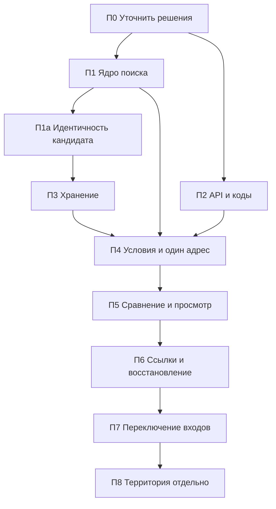

# Переход к задаче поиска: этапы реализации

> Заменён [D13](../../decisions.md#d13-анализ-места-перед-сравнением). План не активен; текст сохранён.

Статус: **согласованная последовательность поставок**; каждый следующий этап требует поручения. Основной результат — путь **условия → адреса → сравнение → просмотр**; территория идёт после него. Основные публичные входы прежние; отдельная оболочка П4.1 доступна на `/search`. Этот документ задаёт порядок и критерии завершения, не повторяет предметный контракт.

## Ближайшая очередь

Это основное место статусов, зависимостей и исполнителей перехода. П1/П1а, П2 и П3 реализованы изолированно; П4.1 — оболочка в рабочем дереве без ядра/API/хранения. Сквозная приёмка П4 впереди; новый прогон приложения этой записью не подтверждается.

Следующая задача для поручения — первая со статусом **к исполнению**; критерии ближайших задач ниже. В общем checkout работает один исполнитель. Поручение на код ещё не дано, готовность задачи не запускает её автоматически.

| Задача | Статус | Исполнитель | Начинать после | Ревью результата |
|---|---|---|---|---|
| П4.2а — редактор выбранного важного места | К исполнению | DeepSeek | П4.1 | Достаточно отчёта и целевых проверок |
| П4.2б — подключение условий к владельцу поиска | В очереди | Codex | П4.2а | Предметная проверка в рамках реализации |
| П4.3 — поиск и явный выбор адресов кандидатов | В очереди | Codex | П4.2 | В рамках реализации: идентичность и поздние ответы |
| П4.4 — расчёт, очередь, API и подключение хранения | В очереди | Codex | П4.3 | В рамках реализации: независимость и приватность |
| П4.5 — профиль и причины частичных отказов | В очереди | Codex | П4.4 | В рамках реализации: контракт результатов |
| П4.6 — карта и проекции результатов | В очереди | Codex | П4.5 | В рамках реализации: контекст и геометрия |
| П4.7 — мобильная шторка, прокрутка и фокус | В очереди | DeepSeek | П4.6 и готовые props/emits | Целевой diff Codex |
| П4.8 — приёмка законченного пути одного адреса | В очереди | Codex | П4.2–П4.7 | По критериям всей П4 |
| П5 — сравнение и просмотр | В очереди | Codex | П4 | По критериям П5 |
| П6 — ссылки и безопасный вход | В очереди | Codex | П5 | По критериям П6 |
| П7 — переключение основного входа | В очереди | Codex | П6 | По критериям П7 |
| П8 — методика территории, затем отдельная реализация | В очереди | Codex | П7 и решение владельца о методике/бюджете | Предметная приёмка методики и GIS |

Статус обновляется в строке задачи. Перед исполнением уточняются её неизвестные входы. Будущие поставки имеют ответственного; задачи DeepSeek выделяются при понятном интерфейсе и самостоятельном результате.

Статусы: **в очереди → к исполнению → в работе → выполнено**; для блокировки указывается причина. «К исполнению» означает определённые результат, границы, зависимости, исполнителя и проверки. «Выполнено» требует результата по критерию и отчёта с фактически выполненными проверками и ограничениями. Источник общих этапов и критериев версии — [roadmap](../../plans/roadmap.md#карта-ближайшей-версии); новые идеи — [гипотезы](../../plans/product-hypotheses.md).

## 1. Основа и границы

- Что должно происходить: [контракт задачи и состояния](search-task-contract.md).
- Что сохранять и заменять: [карта изменений](interface-replacement-plan.md).
- Как устроить состояние и эффекты: [проект владельца поиска](search-task-owner-design.md).
- Визуальная основа: [девять макетов и их ограничения](search-task-mockups/README.md). Текстовый контракт имеет приоритет; недостающие состояния задаются правилами, а не угадываются по изображениям.
- Команды проверок и побочные эффекты: [testing](../../testing.md), [browser-smoke](../../browser-smoke.md).

Номера П0–П8 локальны, не заменяют E/G/Stage. Сведения о завершённых изолированных поставках — в разделах 3–6, текущая очередь — выше; старые прогоны не означают готовности следующего этапа.

Внутренний вход новой оболочки — `/search` через существующие Blade и `app.js`, без флагов и нового router. До П7 публичный `/` и прямые страницы продолжают прежнее поведение. Не добавлять постоянную третью версию UI, новый router или универсальную систему флагов только ради перехода. Старые владельцы состояния не монтируются внутри нового поиска.

**Решение владельца 02.11.2026:** UI пишется с нуля. Старые страницы, компоненты, composables и owners не используются даже транзитивно/type-only. Разрешены независимое ядро П1/П1а, API, типы, чистые утилиты и картографические примитивы по [списку карты](interface-replacement-plan.md#5-карта-утилиты-типы-и-api); импорт-тест проверяет и ядро. C1/C2 приняты, legacy-матрица — раздел 10 контракта. Старый UI пока не изменяется и не удаляется.

Основа новой реализации: **shadcn-vue, Reka UI, Tailwind v4**, без других UI-китов. Компоненты добавляются через CLI в контейнере `node` от пользователя `node`, только по заданию реализации. Новый корень — `resources/js/search-ui/`, стили — `resources/css/search-ui.css`. В П4.1 `components.json` уже настроен на изолированные компоненты и helpers нового UI. Перед следующим CLI-вызовом сверить конфигурацию и просмотреть diff/зависимости; один `--path` не гарантирует изоляцию всех helpers. Старые компоненты не перезаписывать.

Компоненты по потребности задачи: Sidebar — разделы; Table — desktop-сравнение, на мобильном карточки; Toggle Group — режим места; Number Field — необязательный порог; Combobox/Command — явный выбор объекта. Badge отделяет ориентир/статус от результата, Alert показывает постоянные ошибки и сохранение, Alert Dialog — подтверждение удаления, Dialog — выбор/подробности с возвратом фокуса. Empty/Skeleton различают пустоту и загрузку. Collapsible/Tooltip — вторичные сведения, важное доступно без hover; Sonner — короткие уведомления, не статус записи. Drawer требует трёх положений, focus/scroll/snap points; при непригодности — своя pointer-шторка.

В П4 проверить фактическую поддержку snap points установленными [Reka Drawer](https://reka-ui.com/docs/components/drawer) и [обёрткой](https://www.shadcn-vue.com/docs/components/drawer). [CLI](https://www.shadcn-vue.com/docs/cli) может добавлять зависимости: проверить конфигурацию и вывод.

В задании реализации добавить **`lucide-vue-next`** и dev-зависимость **`@axe-core/playwright`**. Текущий `@lucide/vue` не заменяет выбранный пакет; новые сгенерированные импорты сверять с ним, старые не менять попутно. Цвета мест, статусов и кандидатов — в токенах **`@theme`**; карта получает значения из этих токенов без второй палитры. Один новый компонент места по **`placeId`**, без отдельных копий для А/Б; цвета кандидатов не зависят от временной роли пары. **Pinia, готовые обёртки MapLibre и графики не добавлять и не подключать. `h3-js` — только П8.**

Browser-приёмка: настоящий frontend, синтетические API, `@axe-core/playwright`, скриншоты Playwright с маской нестабильного canvas карты. Кнопки, метки, легенда и панели не скрываются маской; функциональные проверки MapLibre/геометрии сохраняются отдельно. Маска не доказывает правильность маршрутизации. Это требования будущих поставок, не сегодняшняя установка/проверка UI.

## 2. Зависимости и точки согласования

Зависимость означает готовый проверенный результат, не необходимость одного огромного PR. Чистые кодеки ссылок можно готовить после П1, API — независимо от хранилища; интеграционная приёмка остаётся в указанном порядке. Одна поставка может содержать несколько небольших коммитов, но не объявляется завершённой до своего сценария.

Принятые решения не открываются заново: маркер хранения — раздел 5 контракта; схемы П2 — контракт профиля и diagnostics ниже; шторка — раздел 8 контракта. В П4 подключаются готовые модули, их наличие не означает подключённый UI.

Оставшиеся зависимости: C2-адаптер и проверки нужны до П7; до переключения старые входы прежние. После П7 только два разрешённых адресных входа открываются временно, остальные несовместимы. Методика H3, сочетания неизвестности/превышения, отсутствие порога, разрешение и бюджет утверждаются до вычислительной П8; основной путь территории не требует.

Согласование решения не разрешает автоматически следующую поставку. На следующий этап реализации нужно отдельное поручение в пределах его границ. Подключение skills также требует отдельного поручения и не является скрытой частью API или UI.

## 3. П0 — подготовить первое задание реализации

**Завершено:** согласованы границы документа/runtime/view и подготовлено задание П1. Это не разрешение переключать `/`, удалять старый UI или устанавливать инструменты. Повторный аудит всех компонентов не нужен; проверять изменившиеся после baseline зависимости карты.

## 4. П1 — чистое ядро задачи поиска

**Статус 01.11.2026:** реализовано изолированное [ядро](../../../resources/js/search/task.ts); целевые frontend-тесты, typecheck и check-docs прошли тогда. Зависимость — П0. Команды и проекции работают без DOM/сети/БД; UI/HTTP/storage этой поставкой не подключены. Модули, границы и проверки — [frontend-structure](../../frontend-structure.md#ядро-нового-поиска-п1); поведение — [целевой контракт](search-task-contract.md). Готовность ядра не означает готовность пользовательского пути.

### Корректировка П1а перед хранением

**Статус 01.11.2026:** П1а реализована изолированно; целевые тесты и typecheck прошли тогда. Уточнённая идентичность кандидата и исключение для подтверждённого missing — [раздел 4 контракта](search-task-contract.md#4-условия-актуальность-и-устаревшие-значения). Старую модель обычной замены с переносом заметок не использовать. П1а предшествует хранению; независимость ядра от старого UI проверяется импорт-тестом по C1.

## 5. П2 — API без скрытого расчёта и полный реестр причин

**Статус 01.11.2026:** реализованы resolver без аналитики, выбранные блоки profile v1, отдельные клиентские типы и структурированные ошибки, backend-каталог и независимый UI-реестр с тестом полноты. Публичный UI/owner пока не подключены к этим операциям.

Фактические схемы, ошибки и whitelist — [контракт профиля](../../features/address-profile.md#только-выбранные-блоки-контракт-v1); область каталога/локализация — [diagnostics contract](../../features/local-routing-diagnostics-contract.md#авторитетный-каталог-и-реестр-нового-поиска). Эти документы имеют приоритет над примерными URL из технического предложения.

Проверки той поставки: целевые PHP unit/feature, frontend-регрессии клиентов/реестра, typecheck и совместимость полного профиля на синтетических fixtures в защищённой web_gis_test. Рабочая БД, реальные OSRM/ORS и браузерная UI-приёмка этим не подтверждены. Команды, окружение и ограничения — [testing](../../testing.md).

## 6. П3 — хранение и удаление

**Статус 02.11.2026:** П3 реализован изолированно: кодек, транзакции, маркер и адаптер состояния. [Модули и проверки](../../frontend-structure.md#хранение-нового-поиска-п3); публичный UI не подключён. **Зависимость:** П1а. **Результат:** один версионированный поиск сохраняется и восстанавливается без чисел результатов и без автозапуска расчёта.

Поведение и гонки — [раздел 5 контракта](search-task-contract.md#5-сохранение-и-удаление), устройство — [проект owner](search-task-owner-design.md#7-локальное-хранение-и-несколько-вкладок). Кодек и команды проверяются целевыми тестами, транзакции и несколько вкладок — настоящим IndexedDB в изолированном origin. Не заявлять транзакционность разных хранилищ или готовность сохранения в ещё не подключённом UI.

## 7. П4 — законченный путь одного кандидата

**Зависимости:** П1–П3. Поставка разбита владельцем на отдельные сессии; П4.1 реализует только оболочку, не весь сценарий. Публичный `/` до П7 прежний.

П4.1 — оболочка `/search`, CLI Button и guards импортов/строк; последующие части и исполнители перечислены в очереди. П4.2 включает места, режим каждого, необязательный ориентир и общий радиус; карточки ближайших задач — ниже.

**Граница:** новый UI с нуля по разделу 1. П4.1 не импортирует owner, хранение и API; подключение и асинхронные адаптеры — последующие части. DeepSeek получает только ограниченные компоненты с props/emits, без новых зависимостей; асинхронные куски и сопоставление кодов остаются Codex. В конце сессии коротко: сделано, дальше, проверено.

### П4.2а — редактор выбранного важного места

**Результат:** контролируемый компонент названия, режима и необязательного ориентира выбранного места. Исполнитель/ревью — в очереди. Контекст: [контракт, разделы 2 и 4](search-task-contract.md#2-сущности-идентичность-и-пределы), [границы П4.1](../../frontend-structure.md#оболочка-нового-поиска-п41); читать нужные разделы.

Границы: props/emits, каталог search-ui, строки в его copy; без HTTP, хранения, нового owner, пакетов и расширения import-policy. Радиус принадлежит поиску и не становится полем отдельного места. Существующую незавершённую работу сохранить.

**Готово, когда:** props задают значения, события передают изменения; режимы различаются; пустой ориентир даёт null, ноль/отрицательное/нечисло отклоняются; подписи доступны, поля помещаются на 320 px. Проверки: целевой frontend-тест, import/copy guards, typecheck в node от пользователя node. Browser-подключение — П4.2б; один компонент не закрывает П4.2.

### П4.2б — работающий раздел условий

Выбор/редактирование мест и общий радиус подключаются через существующее ядро как единственного владельца. При подготовке определить адаптеры адреса/точки и нужное расширение allowlist. Очередь аналитики и сохранение — П4.4; до этого статус временной работы честный. Исполнитель/зависимость — в очереди.

**Готово, когда:** места, индивидуальные режимы/ориентиры и общий радиус редактируются; навигация сохраняет ввод, лимит трёх объясняется, аналитика не запускается. Проверки: целевые frontend/typecheck, guards и browser подключения, позднего выбора, клавиатуры/адаптивности. Оба входа «адрес или явная точка» проверяются до закрытия П4.2.

**Приёмка всей П4:** один адрес проходит путь условия → явный расчёт → профиль через новое ядро/API/хранение. Добавление, навигация и выбор улицы не запускают аналитику. Проверить пустой поиск, отсутствие мест, смешанные режимы, loading/частичный отказ, stale/сброс и поздние ответы; статус записи не выдумывается. Территория не вычисляется и не блокирует адреса.

Тест `tests/frontend/search-ui-imports.test.mjs` использует точный manifest `tests/frontend/fixtures/search-ui-import-policy.json`, проверяет новый UI и ядро П1/П1а/П3, включая типы и транзитивные зависимости. Запрещённые случаи покрываются отрицательными fixtures; неразрешимые dynamic/glob — отказ. Правила — [карта](interface-replacement-plan.md#будущий-тест-границ-импортов). В П4.1 список UI намеренно строже: только новый каталог и разрешённые пакеты.

Проверки по частям: целевые frontend/typecheck и browser для изменённого поведения; полная П4 — настоящий frontend/MapLibre с синтетическими API, viewport/клавиатура/фокус/короткий экран, просмотр снимков, axe, masked screenshots и тест границ. Drawer/snap points проверяются в П4.7; при необходимости своя pointer-шторка. Не считать П4 завершённым по одному каркасу.

## 8. П5 — сравнение и подготовка к просмотру

**Зависимость:** П4. **Результат:** законченный основной путь до «Просмотра» для списка до пяти кандидатов и выбранной пары.

Объём: назначение/замена А/Б без потери данных кандидата, расчёт пары, сравнение чисел отдельно от ориентиров, маршрутные проекции и возврат к строке. Раздел «Просмотр» привязан к кандидату: заметки, чек-лист с исходными основаниями, изменение/исчезновение объекта. Адаптивная таблица становится карточками; шторка и прокрутка выполняют согласованные правила. Единого рейтинга/победителя не вводить.

**Проверки:** целевые frontend и browser для пары, заметок/чек-листа и карты. При смене пары запрос остаётся у исходных ID; при смене адреса/режима зависимые результаты сбрасываются. Радиус даёт stale окружения; stale-число приглушено с исходными условиями, без оценки порога и актуальной линии. Неизвестность имеет причину/действие, выбор дороги не считается успехом. Сбой одной ячейки не скрывает другую. Reload сохраняет ввод/заметки, а не расчёт. Лимит 5 не порождает кнопку неоговорённого массового расчёта списка.

**Дополнительная приёмка П5:** сравнение, заметки и карта используют только новые компоненты/composables и allowlist П4; старые `Comparison*`/`Home*` не подключаются. Единый компонент места по `placeId`, токены `@theme`, импорт-тест, axe и синтетические снимки с маской карты покрывают пару, карточки и шторку.

**Готово, когда:** правило реализации с нуля и тест границ выполнены; условия → адреса → сравнение → просмотр доступны целиком, включая пустые/частичные состояния и одного кандидата. Макеты проверяются как композиция, контракт — как поведение. До реального запуска маршрутизаторов результаты synthetic smoke не выдаются за доказательство GIS.

## 9. П6 — обмен и восстановление контекста

**Зависимости:** П3, П5. **Результат:** обе новые ссылки и безопасный вход; ограниченный адаптер C2 по разделу 10 контракта подготовлен к П7.

Объём: отдельный кодек ссылки и новые локальные ID при импорте; «Поделиться адресами» и «Поделиться вместе с моими местами» с предупреждением. Incoming проходит валидацию до применения. Сохранённый поиск предлагает временное открытие / замену / отмену. Back/Forward меняет представление, не откатывает личные правки и не рассчитывает данные. Точные ограничения и состав — в контракте/проекте owner, не во второй копии формата здесь.

**Проверки:** round-trip нового кодека, версия/refs/координаты и UTF-8-бюджет, три действия incoming при успехе/отказе storage, приватность двух вариантов ссылки в разных browser contexts. Для C2: оба адресных входа с пустым/сохранённым/недоступным storage — без записи и расчёта; отказ resolver и missing различаются. `/trips`, личные точки/fragment, смешанные/дублированные параметры, неизвестная версия и корневые legacy-входы — несовместимость без частичного импорта. Кнопка нового поиска не затирает сохранённое. Личные fragment не попадают в query/журналы/referrer/сетевые тела.

**Готово, когда:** новая ссылка воспроизводит только оговорённый ввод, не стирает прежний поиск до подтверждённой записи; временный режим не автосохраняется. Два допустимых адресных legacy-входа открываются только временно, без аналитики и записи даже при пустом storage; остальные дают несовместимость и кнопку нового поиска. Смешанный вход не разбирается частично.

## 10. П7 — переключение публичных входов

**Зависимости:** П4–П6, проверенный адаптер принятой совместимости, рассмотренные ограничения приёмки. **Результат:** новый основной путь становится публичным, выбранная судьба прежних страниц выполнена без молчаливой потери ссылок/данных.

Перед переключением:

1. Проверить C2: `/address/{id}` и `/compare` с валидными адресами — временный новый поиск без расчёта/записи; остальные старые входы несовместимы. Старые страницы после П7 не монтируются. До П7 поведение прежнее.
2. Сопоставить регрессии карты замены с новыми тестами: сохраняем / адаптируем ожидание / заменяем защитой того же поведения. Пять известных short-desktop сбоев из раздела 8 карты должны получить проверенный исход, а не исчезнуть вместе со старым тестом.
3. Выполнить расширенную приёмку затронутых общих модулей: frontend/typecheck и browser-сценарии нового пути, выбранных legacy-входов, поиска, карты/слоёв, приватности, поздних ответов, истории и удаления. Полный набор нужен при общей области изменения, а не как обязательный ритуал каждой предыдущей поставки.
4. Разделить технический synthetic smoke, проверку настоящего API/маршрутизатора в согласованном окружении и UX-приёмку владельцем. Зафиксировать фактически выполненное; физический телефон/screen reader не считать проверенными по desktop viewport. Реальная проверка окружения требует своего задания и не разрешена этим планом.

**Дополнительная приёмка П7:** весь новый UI, ядро П1/П1а и публичный entry проходят тест границ П4, включая транзитивные импорты и CSS; старые страницы/компоненты/composables/owners не становятся зависимостями нового корня. Основа UI, токены, постоянный статус записи, axe и masked screenshots соответствуют разделу 1. Нарушение критерия C1, матрицы C2 или запретов C3/C4 блокирует переключение.

**Готово, когда:** правило реализации с нуля соблюдено и есть принятая проверка основного сценария и разрешённых legacy-входов; существенные неустранённые ограничения названы явно. Для смены точки входа заранее подготовить обратимый кодовый патч, не применять Git-откат как побочное действие. Сохранённые пользовательские данные не удаляются ради переключения.

Удаление старой оболочки/owners — отдельная последующая правка после проверки отсутствия потребителей и переноса регрессий. Прямые страницы, API и helpers не удаляются автоматически из-за нового `/`. Старые страницы после П7 не монтируются; физическое удаление их файлов не является условием переключения.

## 11. П8 — территория после основного пути

**Зависимость:** П7 и отдельное утверждение методики. `h3-js` добавляется только в этой поставке, не заранее. **Результат сначала:** короткая методика и измерение бюджета на согласованном синтетическом/тестовом окружении. Вычислительный модуль и UI — следующее отдельное задание по результату измерения.

Методика закрывает открытые вопросы [контракта территории](search-task-contract.md#10-территория-и-границы-перехода): H3/покрытие по режимам, направление к местам, пороги привязки, сочетания превышения/неизвестности, отсутствие личного порога, разрешение/объём матрицы, версионирование входов и срок жизни кэша. Формулировка результата остаётся «по проверенным центрам ячеек».

**Проверки будущей реализации:** отсутствие данных вне покрытия, независимые режимы, порог только перефильтровывает, изменение места/режима требует кнопки, лимиты матрицы и отмена; производный кэш удаляется с поиском и не восстанавливается поздним ответом. Не переносить тяжёлую GIS-обработку в HTTP/frontend и не расширять привязку ради заполнения карты. Если измерение требует нового сервиса/архитектуры, согласовать его отдельно.

**Готово, когда:** сначала принята методика с измеренным бюджетом; затем отдельно принята реализация. Наличие основного пути П7 не обещает готовую территорию.

## 12. Как вести задания и документацию перехода

Для небольшого поручения достаточно ссылки на подготовленную задачу. Правила передачи/ревью — [AGENTS](../../../AGENTS.md#совместная-работа-codex-и-deepseek), обновления контрактов — [индекс docs](../../README.md#как-вести-документацию). Контракт и статус обновляет исполнитель в рамках задания; frontend-structure — при изменении границ модулей. Отдельный документационный этап не обязателен.

Различать публичное поведение и внутренний вход; частичная реализация не делает целевой документ целиком `current`. После перехода действующие правила переносятся в основные контракты без второй спецификации. План хранит статусы и ссылки, не протокол каждого прогона. Skills/CodeGraph не являются условием продолжения; установка требует поручения. Не возобновлять автоматически E1 и старые G/U/V-требования.

## 13. П0: готовое задание на П1

Подготовка П0 и первоначальное задание П1 завершены. Актуальны [границы ядра](../../frontend-structure.md#ядро-нового-поиска-п1) и уточнённый контракт П1а выше. Выполненное поручение не становится второй спецификацией или обязательным стартовым контекстом следующей задачи.
