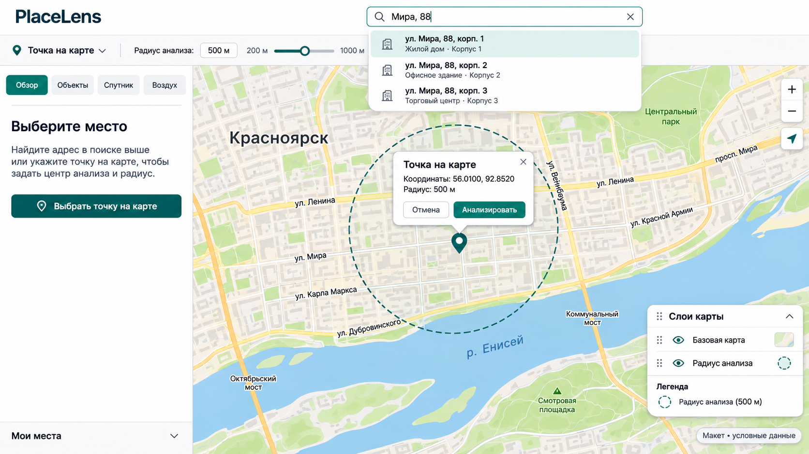
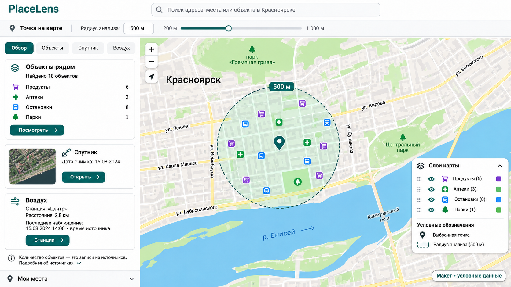
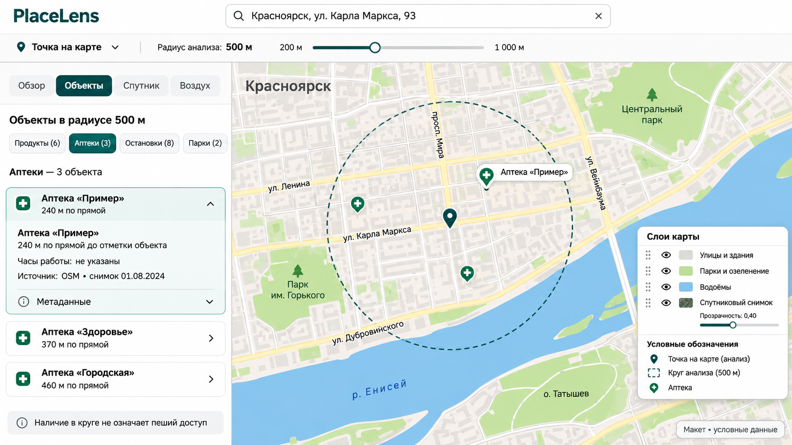
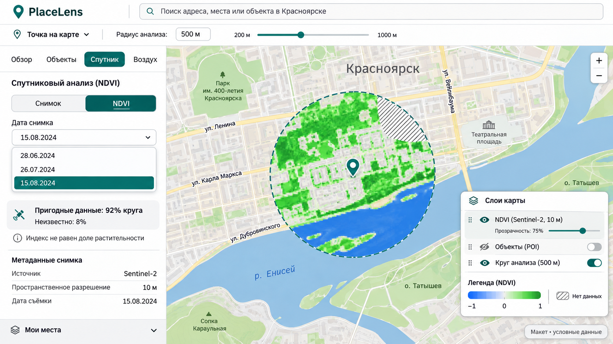
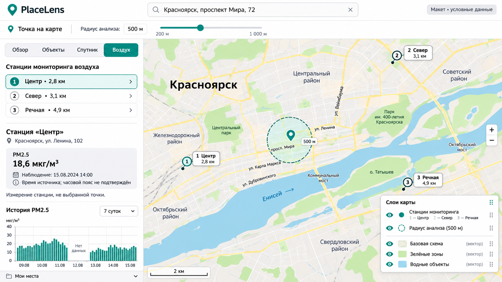
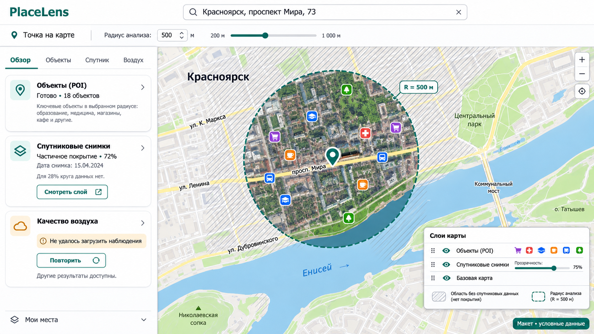

# А6: визуальный референс анализа места

Эти шесть макетов владельца — **основной визуальный ориентир для всех задач создания и изменения UI PlaceLens**. Перед реализацией просмотреть соответствующее состояние и сверять с ним компоновку, визуальную иерархию, цвета, карточки, вкладки и управление слоями. Это не источник данных и не приёмка реализации. Адреса, числа, даты, расстояния, станции, сцены и география на изображениях условны. Реальный контракт полей и состояний — [анализ одного места](../features/place-analysis.md); состав объектов — [D15](../decisions.md#d15-poi-набор-анализа-места).

Основную компоновку брать со [второго изображения](../assets/place-analysis-ui/02-air-primary-layout.png): верхняя шапка с брендом и адресным поиском, строка выбора места и радиуса, левая панель с вкладками и результатами, основная карта и компактная панель слоёв справа внизу. Остальные изображения — **состояния того же экрана**, а не отдельные страницы.

## Что нельзя переносить с изображений

- В первом изображении лишние кафе и образование. В анализе только четыре категории D15: продукты, аптеки, официальные остановки, парки/скверы.
- Штриховка неизвестных спутниковых данных должна показывать пропуски **внутри анализируемого круга**, а не быть декоративной заливкой.
- Не копировать адреса, числа, даты, расстояния, названия станций и геометрию. Все значения на макетах условные.
- Адресный поиск располагать в верхней шапке, как на макетах. Подпись на картинке не добавляет поиск любых организаций к действующему контракту.
- Использовать общий набор вкладок, одно управление слоями и общую ширину боковой панели для всех вкладок. Поведение описано в [основном экране](../frontend-structure.md#основной-экран-анализа) и [карточке станции](../frontend-structure.md#станции-и-история-воздуха).

## Изображения и роль

| Изображение | Что брать | Что не брать |
|---|---|---|
| [Обзор с частичным спутниковым покрытием](../assets/place-analysis-ui/01-overview-partial.png) | Обзорные карточки, статус частичного покрытия, кнопка «Смотреть слой», ошибка воздуха с повтором | Лишние категории, конкретные 72/28%, дату |
| [Воздух: основной карточный макет](../assets/place-analysis-ui/02-air-primary-layout.png) | Основная компоновка: шапка, радиус, вкладки, список станций, выбранная станция, история, карта и слои | Реальные станции, 2,8/3,1/4,9 км, PM2.5, даты и районные подписи |
| [NDVI на карте](../assets/place-analysis-ui/03-ndvi.png) | Переключатель «Снимок / NDVI», список дат, метаданные, легенда, штриховка пропусков внутри круга | 92/8%, 15.08.2024, Sentinel-2 как подтверждение данных |
| [Аптеки и радиус](../assets/place-analysis-ui/04-pharmacies.png) | Вкладка объектов, чипы категорий, список аптек, расстояние по прямой, источник/снимок, ограничение о пешем доступе | Названия аптек, 240/370/460 м, 01.08.2024 |
| [Объекты рядом](../assets/place-analysis-ui/05-objects.png) | Обзор четырёх категорий, счётчики, карточки «Спутник» и «Воздух», сводная карта | 18 объектов, 6/3/8/1, дату снимка |
| [Выбор точки](../assets/place-analysis-ui/06-point.png) | Явный выбор точки, карточка координат, радиус, «Анализировать», подсказка адресного поиска | 56.0100/92.8520 как реальные координаты, 500 м как обязательный радиус |

## Состояния одного экрана

1. **Обзор** — карточки четырёх направлений; частичное покрытие, ошибка и повтор показаны раздельно.
2. **Объекты** — чипы четырёх категорий, список/карта, расстояние по прямой, источник и дата; общее ограничение показывается один раз.
3. **Спутник** — дата, режим «Снимок/NDVI», легенда, покрытие, штриховка неизвестности внутри круга; индекс не равен проценту растительности.
4. **Воздух** — станции вне круга, выбранная станция, время источника без подмены UTC, PM2.5, история и пропуски.
5. **Выбор точки** — точка без адресного ID, карточка с координатами и радиусом, явное «Анализировать».

### Детали «Спутника» и «Воздуха»

Дополнение к ручной приёмке по двум скриншотам владельца.

- **Карточка «Спутник».** Оставить сводную карточку в «Обзоре». Убрать её копию из вкладки «Спутник» и без даты, и после выбора снимка. Если дата не выбрана, достаточно короткой подписи в селекторе. Рядом с ошибкой загрузки оставить компактное действие повтора.
- **Красные отметки.** Убрать два повторных пояснения под процентом пригодности, строку «Версии» из видимой сводки и повтор про исключённые пиксели в деталях покрытия. Охват виден в селекторе. Процент пригодности, средний NDVI, дата и источник остаются в сводке.
- **Оранжевые отметки.** Длинный абзац заменить коротким объяснением в «Как это работает». Там объяснить, почему NDVI не равен доле растительности, что означают прозрачные пиксели и почему увеличение не добавляет деталей. В «Ограничениях набора» оставить только полезные для чтения результата пояснения на русском, технические сведения доступны в паспорте набора.
- **Оранжевые волны.** Выровнять средний NDVI с подписью строки, а «Тёмную поверхность или тень» с остальными причинами исключений. Проверить читаемость названий и чисел на 320 px. Повтор «не процент растительности» перенести в справку.
- **«Воздух».** Рядом со списком станций оставить отдельную кнопку «Обновить». Она перечитывает локальную сводку воздуха. При ошибке истории доступен повтор загрузки ряда выбранной станции.

## Границы референса

Для [поиска Г6](../features/address-search.md#план-два-режима-поиска-г6) использовать кнопку режима в верхней панели, компактные адресные подписи и [единую карточку точки](../features/point-address.md#план-единая-карточка-точки-г6). Проверять также короткий мобильный экран без повторяющихся предупреждений и дублирования адреса.

Изображения не подтверждают GIS, NDVI, воздух, полноту источников, доступность или пользовательскую пользу. Они не добавляют источники, импорты, рейтинг или новые категории. Поведение и данные определяют [контракт](../features/place-analysis.md), [D14](../decisions.md#d14-первый-выпуск-спутников-и-следующий-продуктовый-шаг) и [D15](../decisions.md#d15-poi-набор-анализа-места); текущая очередь — [roadmap](roadmap.md#ближайшая-очередь).

Макеты применяются к единственному основному экрану анализа. Видимые на них будущие функции не запускаются автоматически: объём реализации определяется отдельным поручением и существующей очередью. Для мобильных и узких экранов сохранять эту иерархию с адаптивной компоновкой; desktop-размеры не требуют буквального переноса. Отличия между шестью картинками согласовывать через единую основную компоновку, а не создавать разные оболочки для вкладок.

## Галерея макетов владельца

