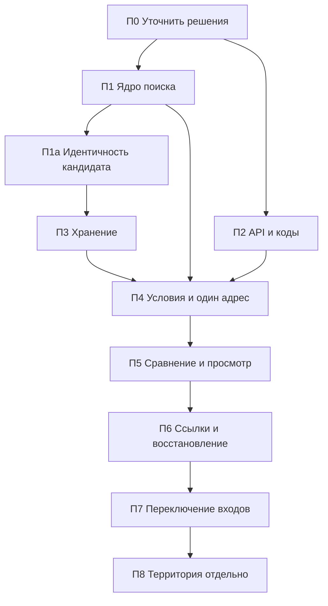

# Переход к задаче поиска: этапы реализации

Статус: **предложение этапа 3**, не поручение реализовать перечисленное. Основной результат — путь **условия → адреса → сравнение → просмотр**; территория идёт после него. Работающее приложение пока не изменено. Этот документ задаёт порядок и критерии завершения, не повторяет предметный контракт.

## 1. Основа и границы

- Что должно происходить: [контракт задачи и состояния](search-task-contract.md).
- Что сохранять и заменять: [карта изменений](interface-replacement-plan.md).
- Как устроить состояние и эффекты: [проект владельца поиска](search-task-owner-design.md).
- Визуальная основа: [девять макетов и их ограничения](search-task-mockups/README.md). Текстовый контракт имеет приоритет; недостающие состояния задаются правилами, а не угадываются по изображениям.
- Команды проверок и побочные эффекты: [testing](../testing.md), [browser-smoke](../browser-smoke.md).

Номера П0–П8 локальны, не заменяют E/G/Stage. П0 завершён; П1/П1а и П2 реализованы изолированно. П3 выполнен изолированно; П4–П8 **не начаты**; старые прогоны не означают их готовности.

Новая оболочка появляется рядом с прежней во внутреннем тестовом входе: конкретный механизм выбрать в задании подключения. До П7 публичный `/` и прямые страницы продолжают прежнее поведение. Не добавлять постоянную третью версию UI, новый router или универсальную систему флагов только ради перехода. Старые владельцы состояния не монтируются внутри нового поиска.

**Решение владельца 02.11.2026:** новый интерфейс пишется с нуля; старые страницы, компоненты, composables и владельцы состояния не используются. Разрешены API-клиенты, типы, чистые утилиты и картографические примитивы; исключение — новое ядро П1/П1а, не импортирующее старый UI прямо или транзитивно. Импорт-тест проверяет и ядро. Запрет относится и к транзитивным/type-only импортам. Список модулей и принятых решений — [разделы 5 и 8 карты](interface-replacement-plan.md#5-карта-утилиты-типы-и-api). Старый UI сейчас не изменяется и не удаляется. C1/C2 приняты: ядро допускается по признаку независимости; ограниченная матрица legacy — раздел 10 контракта.

Основа новой реализации: **shadcn-vue, Reka UI, Tailwind v4**, без других UI-китов. Компоненты добавляются через CLI в контейнере `node` от пользователя `node`, только по отдельному заданию реализации. Новый корень — `resources/js/search-ui/`, стили — `resources/css/search-ui.css`. Перед CLI настроить изолированный вывод компонентов и вспомогательных импортов: текущий `components.json` указывает старые `components`/`composables`; один `--path` не гарантирует изоляцию всех helpers. Просмотреть CLI diff и зависимости, не перезаписывать существующие компоненты.

| Компонент основы | Применение в новом UI |
|---|---|
| Sidebar | Оболочка и разделы одного поиска |
| Table | Desktop-сравнение; на мобильном сопоставимые карточки |
| Toggle Group | Режим каждого места, не общий mode |
| Number Field | Необязательный порог; отсутствие не становится нулём |
| Combobox/Command | Поиск с явным выбором конкретного объекта; текст/группа не подтверждают выбор |
| Badge | Статус/личный ориентир отдельно от результата |
| Alert | Постоянные ошибки и статус сохранения |
| Alert Dialog | Подтверждение удаления с перечнем данных и оговоркой о маркере |
| Dialog | Выбор и подробности с возвратом фокуса |
| Drawer | Три положения шторки; проверить snap points, focus и scroll; иначе своя шторка на pointer events |
| Empty, Skeleton | Пустое состояние и загрузка различаются |
| Collapsible, Tooltip | Вторичные подробности; важная причина/действие доступны без hover |
| Sonner | Только короткие уведомления, например о копировании; статус сохранения постоянный, не тост |

API [Reka Drawer](https://reka-ui.com/docs/components/drawer) описывает snap points; поддержку фактически установленной версии и сгенерированной [обёртки Drawer](https://www.shadcn-vue.com/docs/components/drawer) проверить в П4, а не считать доказанной документацией. [CLI](https://www.shadcn-vue.com/docs/cli) добавляет и зависимости компонентов; сначала проверить фактическую конфигурацию и вывод.

В задании реализации добавить **`lucide-vue-next`** и dev-зависимость **`@axe-core/playwright`**. Текущий `@lucide/vue` не заменяет выбранный пакет; новые сгенерированные импорты сверять с ним, старые не менять попутно. Цвета мест, статусов и кандидатов — в токенах **`@theme`**; карта получает значения из этих токенов без второй палитры. Один новый компонент места по **`placeId`**, без отдельных копий для А/Б; цвета кандидатов не зависят от временной роли пары. **Pinia, готовые обёртки MapLibre и графики не добавлять и не подключать. `h3-js` — только П8.**

Browser-приёмка: настоящий frontend, синтетические API, `@axe-core/playwright`, скриншоты Playwright с маской нестабильного canvas карты. Кнопки, метки, легенда и панели не скрываются маской; функциональные проверки MapLibre/геометрии сохраняются отдельно. Маска не доказывает правильность маршрутизации. Это требования будущих поставок, не сегодняшняя установка/проверка UI.

## 2. Зависимости и точки согласования

Зависимость означает готовый проверенный результат, не необходимость одного огромного PR. Чистые кодеки ссылок можно готовить после П1, API — независимо от хранилища; интеграционная приёмка остаётся в указанном порядке. Одна поставка может содержать несколько небольших коммитов, но не объявляется завершённой до своего сценария.

| Решение / уточнение | Когда обязательно | Что пока допускается |
|---|---|---|
| Техническое подключение owner/очереди | Перед П4; П1/П2 уже изолированно реализованы, IndexedDB с маркером реализован в П3 | Не считать готовые API подключённым UI; П1а предшествует хранению |
| Маркер поколения после удаления | Принят 01.11.2026; правила в разделе 5 контракта | Реализовано изолированно в П3; публичный UI не подключён |
| Точные DTO, URL-схема, допустимые диапазоны, область реестра кодов | В задании соответствующей поставки | Использовать предложенные схемы как вход проектирования, не выпускать несовместимые форматы |
| Три положения мобильной шторки, приоритет прокрутки, состояния и мобильное «Сравнение» | До реализации оболочки П4/П5 | Чистое ядро и API; два недостающих экрана можно подготовить отдельным заданием |
| Старые входы | C2 принят; адаптер и проверки нужны до П7 | До П7 без изменений; после — только два адресных входа во временный новый поиск, остальные несовместимы (раздел 10 контракта) |
| Методика H3, сочетания неизвестности/превышения, отсутствие порога, разрешение и бюджет | До вычислительной реализации П8 | Основной путь без территории |

Согласование решения не разрешает автоматически следующую поставку. На следующий этап реализации нужно отдельное поручение в пределах его границ. Установка CodeGraph/skills также отдельна: это следующий подготовительный блок общего плана, а не скрытая часть API или UI.

## 3. П0 — подготовить первое задание реализации

**Завершено:** согласованы границы документа/runtime/view и подготовлено задание П1. Это не разрешение переключать `/`, удалять старый UI или устанавливать инструменты. Повторный аудит всех компонентов не нужен; проверять изменившиеся после baseline зависимости карты.

## 4. П1 — чистое ядро задачи поиска

**Статус 01.11.2026:** реализовано изолированное [ядро](../../resources/js/search/task.ts); целевые frontend-тесты, typecheck и check-docs прошли. UI/HTTP/storage не подключены. Границы модулей — [frontend-structure](../frontend-structure.md#ядро-нового-поиска-п1).

**Зависимость:** П0 в части модели. **Результат:** проверяемый owner без подключения публичного UI и без настоящих HTTP/storage.

Объём: постоянные ID кандидатов/мест, лимиты, роли А/Б, команды редактирования, адрес/точка, индивидуальные режимы, документ и runtime отдельно. Реализовать отпечатки зависимостей, сброс/stale, проекции и интерфейсы эффектов по проекту owner. Работа с результатом адресуется стабильными ID, а не текущим номером строки. Не переносить старый общий режим и два фиксированных контейнера А/Б под новым названием.

**Проверки:** целевые frontend-тесты настоящей модели с управляемыми портами, typecheck. Матрица включает перестановку пары без потери заметок, пределы 5/3, замену адреса, изменение режима одного места, радиус только для окружения, порог без расчёта, удаление с поздним ответом, сохранность независимых ячеек. Чтение selector/смена раздела не вызывает эффектов аналитики.

**Готово, когда:** команды и проекции работают без DOM, сети и БД; сериализуемый документ не содержит результатов. Результаты этой поставки проверяемы тестами, пользовательский путь ещё не готов.

### Корректировка П1а перед хранением

**Статус 01.11.2026:** П1а реализована изолированно; целевые тесты и typecheck прошли тогда, UI/HTTP/storage не подключены. Обычная смена создаёт нового кандидата, не переносит заметки и не вытесняет старого при лимите. Единственное исключение — явная замена подтверждённого missing новым ID: заметки помечены прежним объектом, результаты/hints/актуальные отметки не переносятся. Подтверждение сверяет ревизию, поколение и evidence; операция при лимите пяти атомарна. Контракт — [раздел 4](search-task-contract.md#4-условия-актуальность-и-устаревшие-значения), текущие границы ядра — frontend-structure. Ядро сохранено по C1; импорт-тест проверяет его независимость от старого UI.

## 5. П2 — API без скрытого расчёта и полный реестр причин

**Статус 01.11.2026:** реализованы resolver без аналитики, выбранные блоки profile v1, отдельные клиентские типы и структурированные ошибки, backend-каталог и независимый UI-реестр с тестом полноты. Публичный UI/owner пока не подключены к этим операциям.

Фактические схемы, ошибки и whitelist — [контракт профиля](../features/address-profile.md#только-выбранные-блоки-контракт-v1); область каталога/локализация — [diagnostics contract](../features/local-routing-diagnostics-contract.md#авторитетный-каталог-и-реестр-нового-поиска). Эти документы имеют приоритет над примерными URL из технического предложения.

Проверки: целевые PHP unit/feature с SQLite in-memory и подменённым HTTP, frontend-регрессии автомобильных/пеших клиентов и реестра, typecheck. Существующая совместимость полного профиля проверена отдельным PostGIS-набором с синтетическими fixtures только в защищённой web_gis_test. Рабочая БД, реальные OSRM/ORS и браузерная UI-приёмка этим не подтверждены. Команды и ограничения — [testing](../testing.md).

## 6. П3 — хранение и удаление

**Статус 02.11.2026:** П3 реализован изолированно: кодек, транзакции, маркер и адаптер состояния. [Модули и проверки](../frontend-structure.md#хранение-нового-поиска-п3); публичный UI не подключён. **Зависимость:** П1а. **Результат:** один версионированный поиск сохраняется и восстанавливается без чисел результатов и без автозапуска расчёта.

Объём: DTO по allowlist, schemaVersion/searchId, ревизии, подтверждённые destructive-команды, конфликт вкладок, ошибки записи и повреждённого/будущего формата. Применить выбранный протокол хранения из [проекта owner](search-task-owner-design.md#7-локальное-хранение-и-несколько-вкладок); не заявлять транзакционность двух разных механизмов хранения.

**Проверки:** тесты маркера/гонок/отсутствия из раздела 5 контракта, затем кодек/команды и настоящий browser storage в изолированном origin: успешная запись, quota/недоступность, успех старой ревизии при новой правке, конфликт двух вкладок, закрытие/versionchange, удаление при запросе в полёте, невозможность восстановления поиска старой вкладкой. Проверить содержимое DTO на отсутствие метрик, calculatedAt и геометрии; reload даёт «Не рассчитано». Ошибка не превращается в «Сохранено на устройстве»; повреждённая запись не затирается.

**Готово, когда:** есть подтверждённые состояния записи и удаления, атомарная замена поиска в выбранном хранилище, явная диагностика частичной очистки настроек. Личные данные настоящего пользователя для этих проверок не нужны.

## 7. П4 — законченный путь одного кандидата

**Зависимости:** П1–П3, правила мобильной оболочки. **Результат:** в изолированном входе пользователь задаёт условия, добавляет один адрес, явно рассчитывает и открывает его профиль без сравнения.

Объём: новая оболочка/владелец, разделы «Условия» и «Адреса», поиск с явным выбором, важное место как адрес или точка, режим каждого места, необязательный ориентир, радиус окружения. Подключить очередь и API, единую кнопку «Рассчитать» для поездок и окружения, независимые блоки и повторы. Повторное открытие, добавление адреса, выбор улицы и правка условий не запускают аналитику.

Территория на этом этапе не имеет работающей карты расчёта: обозначить её ещё недоступное состояние с объяснением либо не давать переход к вычислению. Макет не выдаётся за готовую функцию. Нельзя блокировать ручное добавление адреса отсутствием территории.

**Проверки:** целевые tests owner/диспетчера и typecheck; browser-сценарий с настоящим frontend/MapLibre и синтетическими API. Проверить пустой поиск, нет мест, один кандидат, смешанные режимы мест, loading, частичный отказ, выбор дороги, stale/сброс и поздние ответы. Зафиксировать фактические viewport, клавиатуру, фокус и короткий экран; просмотреть снимки. Resolver-запрос при выборе допустим, аналитических запросов до кнопки нет.

**Дополнительная приёмка П4:** написать `tests/frontend/search-ui-imports.test.mjs` по точному allowlist `tests/frontend/fixtures/search-ui-import-policy.json` из [раздела 5 карты](interface-replacement-plan.md#будущий-тест-границ-импортов). Проверять весь новый UI, ядро П1/П1а и транзитивные зависимости, включая `import type`, aliases, barrels и динамические импорты; запрет нельзя обходить через генератор/тип/CSS. Положительные и отрицательные fixtures обязательны. Сейчас тест только запланирован, не написан. Проверить Drawer snap points/альтернативную шторку, axe для состояний и диалогов, masked screenshots и CLI imports.

**Готово, когда:** весь UI сценария написан заново на основе раздела 1, нет запрещённых импортов, тест границ проходит, включая проверку ядра по C1; весь сценарий одного адреса проходит через новый owner, запись/ошибка видны, числа/причины соответствуют ответу, настоящие API-клиенты не заменены отдельной демо-логикой. Старый публичный вход по-прежнему работает.

## 8. П5 — сравнение и подготовка к просмотру

**Зависимость:** П4. **Результат:** законченный основной путь до «Просмотра» для списка до пяти кандидатов и выбранной пары.

Объём: назначение/замена А/Б без потери данных кандидата, расчёт пары, сравнение чисел отдельно от ориентиров, маршрутные проекции и возврат к строке. Раздел «Просмотр» привязан к кандидату: заметки, чек-лист с исходными основаниями, изменение/исчезновение объекта. Адаптивная таблица становится карточками; шторка и прокрутка выполняют согласованные правила. Единого рейтинга/победителя не вводить.

**Проверки:** целевые frontend и browser для пары, заметок/чек-листа и карты. При смене пары запрос остаётся у исходных ID; при смене адреса/режима зависимые результаты сбрасываются. Радиус даёт stale окружения; stale-число приглушено с исходными условиями, без оценки порога и актуальной линии. Неизвестность имеет причину/действие, выбор дороги не считается успехом. Сбой одной ячейки не скрывает другую. Reload сохраняет ввод/заметки, а не расчёт. Лимит 5 не порождает кнопку неоговорённого массового расчёта списка.

**Дополнительная приёмка П5:** сравнение, заметки и карта используют только новые компоненты/composables и allowlist П4; старые `Comparison*`/`Home*` не подключаются. Единый компонент места по `placeId`, токены `@theme`, импорт-тест, axe и синтетические снимки с маской карты покрывают пару, карточки и шторку.

**Готово, когда:** правило реализации с нуля и тест границ выполнены; условия → адреса → сравнение → просмотр доступны целиком, включая пустые/частичные состояния и одного кандидата. Макеты проверяются как композиция, контракт — как поведение. До реального запуска маршрутизаторов результаты synthetic smoke не выдаются за доказательство GIS.

## 9. П6 — обмен и восстановление контекста

**Зависимости:** П3, П5. **Результат:** обе новые ссылки и безопасный вход; ограниченный адаптер C2 по разделу 10 контракта подготовлен к П7.

Объём: отдельный кодек ссылки и новые локальные ID при импорте; «Поделиться адресами» и «Поделиться вместе с моими местами» с предупреждением. Incoming проходит валидацию до применения. Сохранённый поиск предлагает временное открытие / замену / отмену. Back/Forward меняет представление, не откатывает личные правки и не рассчитывает данные. Точные ограничения и состав — в контракте/проекте owner, не во второй копии формата здесь.

**Проверки:** round-trip нового кодека, версия/refs/координаты и UTF-8-бюджет, три действия incoming при успехе/отказе storage, приватность двух вариантов ссылки в разных browser contexts. Для C2: оба адресных входа с пустым/сохранённым/недоступным storage — без записи и расчёта; отказ resolver и missing различаются. `/trips`, личные точки/fragment, смешанные/дублированные параметры, неизвестная версия и корневые legacy-входы — несовместимость без частичного импорта. Кнопка нового поиска не затирает сохранённое. Личные fragment не попадают в query/журналы/referrer/сетевые тела.

**Готово, когда:** новая ссылка воспроизводит только оговорённый ввод, не стирает прежний поиск до подтверждённой записи; временный режим не автосохраняется. Два допустимых адресных legacy-входа открываются только временно, без аналитики и записи даже при пустом storage; остальные дают несовместимость и кнопку нового поиска. Смешанный вход не разбирается частично.

## 10. П7 — переключение публичных входов

**Зависимости:** П4–П6, проверенный адаптер принятой совместимости, рассмотренные ограничения приёмки. **Результат:** новый основной путь становится публичным, выбранная судьба прежних страниц выполнена без молчаливой потери ссылок/данных.

Перед переключением:

1. Проверить C2: `/address/{id}` и `/compare` с валидными адресами — временный новый поиск без расчёта/записи; остальные старые входы несовместимы. Старые страницы после П7 не монтируются. До П7 поведение прежнее.
2. Сопоставить регрессии карты замены с новыми тестами: сохраняем / адаптируем ожидание / заменяем защитой того же поведения. Пять известных short-desktop сбоев из раздела 8 карты должны получить проверенный исход, а не исчезнуть вместе со старым тестом.
3. Выполнить расширенную приёмку затронутых общих модулей: frontend/typecheck и browser-сценарии нового пути, выбранных legacy-входов, поиска, карты/слоёв, приватности, поздних ответов, истории и удаления. Полный набор нужен при общей области изменения, а не как обязательный ритуал каждой предыдущей поставки.
4. Разделить технический synthetic smoke, проверку настоящего API/маршрутизатора в согласованном окружении и UX-приёмку владельцем. Зафиксировать фактически выполненное; физический телефон/screen reader не считать проверенными по desktop viewport. Реальная проверка окружения требует своего задания и не разрешена этим планом.

**Дополнительная приёмка П7:** весь новый UI, ядро П1/П1а и публичный entry проходят тест границ П4, включая транзитивные импорты и CSS; старые страницы/компоненты/composables/owners не становятся зависимостями нового корня. Основа UI, токены, постоянный статус записи, axe и masked screenshots соответствуют разделу 1. Нарушение критерия C1, матрицы C2 или запретов C3/C4 блокирует переключение.

**Готово, когда:** правило реализации с нуля соблюдено и есть принятая проверка основного сценария и разрешённых legacy-входов; существенные неустранённые ограничения названы явно. Для смены точки входа заранее подготовить обратимый кодовый патч, не применять Git-откат как побочное действие. Сохранённые пользовательские данные не удаляются ради переключения.

Удаление старой оболочки/owners — отдельная последующая правка после проверки отсутствия потребителей и переноса регрессий. Прямые страницы, API и helpers не удаляются автоматически из-за нового `/`. Старые страницы после П7 не монтируются; физическое удаление их файлов не является условием переключения.

## 11. П8 — территория после основного пути

**Зависимость:** П7 и отдельное утверждение методики. `h3-js` добавляется только в этой поставке, не заранее. **Результат сначала:** короткая методика и измерение бюджета на согласованном синтетическом/тестовом окружении. Вычислительный модуль и UI — следующее отдельное задание по результату измерения.

Методика закрывает открытые вопросы [контракта территории](search-task-contract.md#10-территория-и-границы-перехода): H3/покрытие по режимам, направление к местам, пороги привязки, сочетания превышения/неизвестности, отсутствие личного порога, разрешение/объём матрицы, версионирование входов и срок жизни кэша. Формулировка результата остаётся «по проверенным центрам ячеек».

**Проверки будущей реализации:** отсутствие данных вне покрытия, независимые режимы, порог только перефильтровывает, изменение места/режима требует кнопки, лимиты матрицы и отмена; производный кэш удаляется с поиском и не восстанавливается поздним ответом. Не переносить тяжёлую GIS-обработку в HTTP/frontend и не расширять привязку ради заполнения карты. Если измерение требует нового сервиса/архитектуры, согласовать его отдельно.

**Готово, когда:** сначала принята методика с измеренным бюджетом; затем отдельно принята реализация. Наличие основного пути П7 не обещает готовую территорию.

## 12. Как вести задания и документацию перехода

Каждое задание указывает поставку, допустимые файлы/эффекты, её входные решения, конкретный сценарий завершения и необходимые проверки по testing. В отчёте: что реализовано, какие проверки выполнены сейчас, их окружение и ограничения, что осталось. Не переносить старые числа тестов в критерии.

При выпуске поведения обновлять его основной контракт, frontend-structure при изменении границ модулей и одну строку changelog. Пока новое поведение закрыто внутренним входом, явно различать публичную работающую версию и ещё не выпущенную. Целевой документ не становится `current` целиком из-за частичной реализации; после перехода переносить действующие правила в основные контракты без второго независимого источника. Сам план хранит статусы поставок и ссылки, не протокол каждой проверки.

Отдельный подготовительный блок до реализации: согласовать документацию с переходом по уже проведённой чистке, адаптировать выбранные skills и рассмотреть подключение CodeGraph. Эти инструменты не заменяют контракт, проверки и согласование спорных решений. Сейчас они не устанавливаются. Не возобновлять отложенный E1 и старые G/U/V-требования автоматически.

**Ближайший ограниченный шаг:** П4 по отдельному поручению: новый UI с нуля, подключение API/ядра/хранения и запланированный импорт-тест. П1/П1а, П2 и П3 выполнены изолированно; C1–C4 закрыты. Адаптер старых URL C2 и переключение ещё не реализованы.

## 13. П0: готовое задание на П1

Подготовка П0 и первоначальное задание П1 завершены. Реализованные модули и их границы — [frontend-structure](../frontend-structure.md#ядро-нового-поиска-п1), статус завершённого П1а — раздел 4 этого плана. Полный текст выполненного задания не является параллельным источником нового поведения.

Принятый целевой контракт имеет приоритет над первоначальным заданием П1: обычная смена адреса теперь создаёт нового кандидата; исключение переноса заметок — только missing. Целевые тесты П1а проверяют новую семантику. Требования и проверяемый результат П1а перечислены выше; П3 не начинается на старой модели замены.
