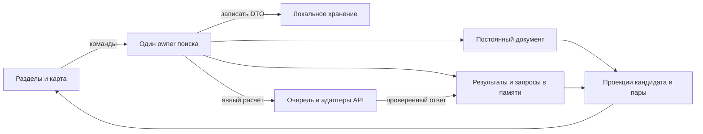

# Владелец задачи поиска: техническое предложение

Статус: **проект этапа 2**; ядро и хранение реализованы изолированно, остальное — цель. Основа — [контракт](search-task-contract.md), [карта замены](interface-replacement-plan.md), исходники `fe6f92d`. Здесь устройство owner, не копия правил экранов. Принятые уточнения 01.11.2026 имеют приоритет; П1а реализовал уточнённую идентичность в изолированном ядре; П3 реализован изолированно; UI ещё не подключён. Приложение/БД не запускались; замена UI и инструменты в задание не входят.

## 1. Единственный владелец и границы

Один `createSearchTask(ports)` на корень поиска; Vue-composable предоставляет readonly-state, selectors и команды через provide/inject. Не owner на вкладку/А/Б/кандидата, не module-level singleton. Новые библиотеки состояния/router не нужны; старые прямые страницы пока независимы.

| Часть | Ответственность | Не делает |
|---|---|---|
| Модель задачи, условно `search/task.ts` | Сущности, команды редактирования, ревизии, инварианты и чистые проекции | HTTP, storage, DOM, GIS |
| Диспетчер `search/calculations.ts` | Снимки входа, очередь, epochs, независимые блоки, применение проверенного ответа | Владение второй копией кандидатов, скрытый запуск из computed/watch |
| Хранение `search/storage.ts` | Явный DTO, schemaVersion, запись ревизий и конфликты вкладок | Сериализация runtime/геометрии/чисел результатов |
| Ссылки `search/links.ts` | Чистые parse/validate/serialize, новый вход и remap ID | Автоприменение входа поверх сохранённого поиска |
| HTTP-адаптеры | Существующие клиенты с сохранением validation и структурированными ошибками; новые адресные операции ниже | Аналитические решения на frontend |
| Представление/адаптер карты | Раздел, шторка, диалоги, фокус, камера и GeoJSON текущих результатов | Запуск расчёта от просмотра или масштабирования |

Файлы условны, универсальная event-bus/repository-система не нужна. Команда меняет состояние и вызывает эффекты через ports. Редактирование может автосохраняться; аналитика — только расчёт/повтор. Selector не создаёт ячейку или запрос.



## 2. Данные и идентичность

| Слой | Содержимое |
|---|---|
| `SearchDocument` | `searchId`, `documentRevision`, candidates/order (до 5), places/order (до 3), pair, radius, streetChoices, notes/checklists |
| `Candidate` | `candidateId`, `selectionRevision`, подтверждённый адресный ID, сохранённые подпись/исходная точка и известное происхождение выбора |
| `Place` | `placeId`, `selectionRevision`, label, `selection: address | point`, mode, thresholdMinutes или null |
| `address`-выбор | Точный OSM ID, подпись и координаты выбора; группа address:hash не принимается |
| `point`-выбор | Явные lon/lat и пользовательская подпись, без адресного ID |
| `streetChoices` | Явный пользовательский ввод для `(candidateId, placeId, mode)`: startRoad/targetRoad, ревизии исходных выборов; не engine snaps или список предложений |
| `SearchRuntime` | generation, разрешённые текущие адресные объекты, cells поездок, результаты окружения, request tokens/controllers, очередь и временный кэш |
| `ViewState` | Раздел, открытый кандидат, диалоги, выбранная поездка, scroll/камера; отделён от документа |

Локальные ID не зависят от порядка/координат/А/Б и не переиспользуются. Пара содержит разные существующие ID, допускает пустые роли. Переименование меняет documentRevision, не selectionRevision расчёта.

Уличный ввод относится к поездке: один кандидат может иметь разные startRoad для разных мест, не единственный `candidate.road`. Смена mode/исходной точки удаляет зависимые choices. Backend candidates — только runtime текущего ответа; сохраняется лишь явный пользовательский выбор для повторной проверки.

Сохранённые координаты адреса — сведения прошлого выбора, не fallback при исчезновении ID. Отдельный resolver проверяет адрес в текущем наборе без аналитики. `resolved`, `missing`, `source_unavailable`, `request_error` различаются. При том же ID и изменившейся точке актуальный resolved-input получает новую ревизию, зависимые данные/choices инвалидируются; локальный ID и заметки сохраняются с исходным основанием. При missing маршрут от старой координаты не запускается. Важное место-точка не требует разрешения адреса; подпись остаётся дополнительной.

## 3. Команды и переходы

| Команды | Переход/эффект |
|---|---|
| `addCandidate`, `addPlace`, `setPlaceSelection` | Смена адреса создаёт нового кандидата/ID; проверка лимита без вытеснения. Старый кандидат остаётся до подтверждённого удаления; resolver без аналитики |
| `prepareMissingCandidateReplacement` / `replaceMissingCandidate` (П1а) | Только подтверждённый missing и явное согласие: новый candidateId, перенос заметок с исходным адресом и пометкой прежнего объекта, без результатов/уличных выборов/актуальных отметок |
| `setPlaceMode`, `setStreetChoice` | Mode сбрасывает зависимые поездки/choices; street-команда заменяет указанный конец и сбрасывает его поездку, без запуска |
| `renamePlace`, `setThreshold`, `assignPair` | Только документ/проекция, сохранение; без инвалидации числового маршрута |
| `setRadius` | Окружение становится stale, поездки сохраняются; без запроса |
| `calculateCandidate`, `calculatePair` | Снимок выбранных ID/условий; очередь поездок и окружения, независимо от последующей перестановки А/Б |
| `retryTrip`, `retryEnvironmentBlock` | Только отказавшая ячейка/блок при допустимом действии реестра; без повтора всего поиска |
| `editNote`, `setChecklistMark` | Документ и запись; отметка не меняет backend-статус |
| `confirmDelete*`, `confirmReplaceIncoming` | Проверка подтверждённой ревизии/перечня данных, отмена эффектов, транзакционная операция и применение результата |
| `openIncomingTemporarily`, `cancelIncoming` | Временный runtime либо сохранение прежнего контекста; без перезаписи постоянной задачи |
| `navigate`, `showTrip`, `returnToRow` | Только ViewState; аналитика и documentRevision не меняются |

Удаление подтверждает ID/ревизию перечня; изменившийся состав требует нового подтверждения. Постоянное удаление завершается после записи, временное — в памяти. Отмена запроса не является отказом сервиса.

Смена адреса не меняет объект существующего кандидата: создаётся новый. Перемещение точки того же ID в источнике инвалидирует его окружение/поездки; изменение места/режима — поездки к нему у всех кандидатов. Удаление места очищает его cells/choices/кэш. Непричастные результаты сохраняются. Порог, подпись и роли не отменяют нужный запрос. Радиус отменяет только ожидающее/идущее окружение старого радиуса. Новый явный расчёт меняет tokens затронутых ячеек, не глобальную эпоху всего поиска.

## 4. Результаты и отпечатки

Ячейка поездки индексируется `(candidateId, placeId)`, окружение — `(candidateId, blockKey)`. Mode входит в снимок входа, а не разрешает показать результат другого режима. Оболочка ячейки разделяет:

- `phase`: not_calculated, queued, loading, settled, request_error;
- `freshness`: none, current, stale;
- проверенный backend response (в том числе NO_PATH/UNKNOWN), исходные условия, calculatedAt и provenance;
- inputStamp, epoch и нормализованную ошибку запроса отдельно от backend-статуса.

Время расчёта берётся из `calculated_at` метрики/блока, а не времени получения ответа; несовпадающие даты не сливаются в выдуманное общее время. `receivedAt` допустим только как отдельное техническое поле runtime.

`AVAILABLE` — не фаза запроса; `READY` не гарантирует доступность метрик. Частичные причины и действия определяет [реестр](search-task-contract.md#9-скелет-реестра-кодов), без общего рейтинга/ложного успеха.

`inputStamp` канонизирует ID/selectionRevision, фактические координаты, mode, road choices; для окружения — candidate selection/radius. Исключены label, threshold, роли, notes, documentRevision и порядок ключей. SHA не заменяет validation. Версии данных/графа/метода берутся из ответа; единый атомарный снимок поиска не обещается.

Запрос захватывает `generation + cell epoch + inputStamp + index→stable ID`. Применение — после проверки зависимостей и HTTP/scope/identity; abort лишь дополнение. Правка заметки не отвергает ответ, удаление/замена ID отвергает даже при тех же координатах. Engine snap не записывается как выбор пользователя.

Stale показывает прежнее число приглушённо, с исходными условиями/временем, без оценки порога и актуальной линии. Сброшенный результат не показывается. При повторной проверке того же ввода предыдущие значения могут быть видны как «Предыдущий расчёт, выполняется проверка», не как «условия изменились»; до нового принятия оценки/линия этой ячейки скрыты. Независимые ячейки остаются действующими. После ошибки повтора прежнее значение не выдаётся за новый успех.

## 5. Диспетчер и ограничения API

Команда пары фиксирует не более двух candidateId и до трёх мест. Для каждого кандидата поездки группируются по `(mode, startRoad)`; targets и их hints остаются в конкретной группе, не более трёх целей на запрос. При разных startRoad безопаснее отдельные запросы. Порядок ответа связывается только с захваченным index→placeId, не с текущим порядком списка.

Для пары максимум **6 trip-запросов и 2 запроса окружения**, без дополнительных resolver-запросов. Предлагается общая очередь с не более **2 одновременных аналитических HTTP**; это технический стартовый предел, не увеличение backend-лимитов. Очередь проверяет inputStamp до отправки; устаревшая работа снимается без запроса. Временная ошибка одной группы не отменяет другую. Дублирующий запуск одинакового задания блокируется, явный новый запуск отменяет старое затронутое задание.

Маршрут имеет текущий throttle `30/min` на API; два параллельных запроса не гарантируют отсутствие 429 при повторных действиях или других страницах. 429 останавливает отправку новых trip-заданий этой команды, сообщает допустимый срок повтора, если дан Retry-After; автоповтора нет. Новая команда пользователя после ограничения проходит тот же бюджет, а не обходит его. Окружение/готовые ответы сохраняются независимо. Таймауты и guards не расширяются ради успеха.

Ошибки: `http(status, code?, retryAfter?)`, network, timeout, invalid_response, cancelled. Код не выводится из message. В [fetchTrips](../../resources/js/api/trips.ts) нужно сохранить HTTP-статус вместо текстового Error, не потеряв no-store/no-referrer и walking validation. Сырые ответы/личные тела не логируются.

## 6. Разрешение адреса и выбранные блоки окружения

**Предлагаемое дополнение backend**, без миграции БД и изменения GIS-методик:

1. `GET /api/v1/addresses/{id}` — разрешение точного ID в активном снимке. Возвращает адресную часть существующего профиля: ID, подпись, объект/точку/geometry/bounds, происхождение, даты и возможности версии API. Не вызывает transport/area/linear calculations или сборку аналитических map layers. 404 отличается от 503 источника и сетевого отказа. Общая адресная операция извлекается из [AddressProfileService](../../app/Services/Addresses/AddressProfileService.php), не копируется вторым несовместимым запросом. Небольшие resolver-запросы ограничиваются очередью; повтор ID можно объединить, но каждой сущности сохранить свою проверку ревизии.
2. Существующий profile API по умолчанию сохраняет полный ответ для прямых страниц. Добавляется явно версионированный режим выбранных блоков, например `scope=selected&blocks[]=transport&radius_m=500`; whitelist — transport/parks/vegetation/water/roads/railways. Он фиксирует снимки один раз и считает только запрошенные блоки и относящиеся к ним layers. Ответ явно сообщает версию/набор рассчитанных блоков, ID и radius; незапрошенный блок отсутствует, не ERROR и не ноль.

Операция resolver объявляет поддержку selected-profile. При неподдерживаемой версии клиент не отправляет «частичный» запрос старому серверу и не делает скрытый fallback на полный расчёт. Полный и частичный ответы имеют отдельные клиентские типы/validation, старый AddressProfile не ослабляется до набора необязательных полей.

Обычный «Рассчитать» запрашивает все блоки окружения; «Повторить» одного ERROR-блока — только его. Принимается только соответствующий ответ. Остальные блоки сохраняют собственные calculatedAt/снимки; смешанные версии не выдаются за единый атомарный снимок. Если профиль сообщает новую точку объекта, она проходит resolver-проверку и инвалидацию; поездки от старой точки не принимаются рядом как текущие. Только отбор старых блоков на frontend при повторном полном backend-расчёте не выполняет требование точечного повтора.

## 7. Локальное хранение и несколько вкладок

**IndexedDB без библиотеки реализован в П3**, модули/границы — [frontend-structure](../frontend-structure.md#хранение-нового-поиска-п3) для транзакционной замены и проверки ревизии между вкладками. Пересекающиеся readwrite-транзакции [упорядочиваются](https://www.w3.org/TR/IndexedDB/#transaction-scheduling); успех — событие [complete](https://developer.mozilla.org/en-US/docs/Web/API/IDBTransaction/complete_event), не put.success. Отказы/совместимость проверяются при реализации; очистку браузера это не предотвращает.

Хранилище содержит один active-envelope и служебный control-record. DTO создаётся по allowlist, не JSON.stringify(owner):

```text
schemaVersion: 1
searchId, documentRevision, storageRevision
candidates + order, places + order, pair, radius
explicit streetChoices, candidate notes/checklists + исходные основания
```

Не сохраняются response, geometry, metrics, calculatedAt, runtime/preview, списки улиц и кэш. Исходные координаты/hints — ввод, не маршрут. После открытия cells пустые. Неизвестная schemaVersion/повреждённый DTO не перезаписывается: ошибка, отмена или временный поиск. Версии IDB и DTO раздельны.

Удаляющая вкладка получает новое поколение из своей транзакции и принимает его только при complete; без перезагрузки разрешена следующая запись нового поиска. При abort остаётся прежнее поколение. Проверки обоих видов удаления включены в контракт П3.

Запись проверяет `(storageEpoch, searchId, storageRevision)` в **той же readwrite-транзакции** и увеличивает storageRevision. При подтверждённом удалении более поздняя ревизия того же searchId, завершившаяся перед транзакцией удаления, тоже стирается по окну гонки контракта; другой searchId/поколение не удаляются. Для обычной записи ревизия совпадает точно. Снимки записываются последовательно; успех N не подтверждает N+1. Внешнее изменение — конфликт без автоматического merge/перезаписи; локальные правки остаются в памяти. Действия: открыть сохранённое или продолжить временно. History не восстанавливает прежний документ.

Правки видны сразу и автосохраняются, ошибка даёт «Не сохранено» и повтор. Замена/удаление готовятся на копии, прежняя запись остаётся до commit. Затронутые запросы отменяются; поздний callback не пишет. При неудаче отменённая загрузка не остаётся spinner и не запускается сама.

`storageEpoch` — принятый 128-битный случайный маркер; генерация, отсутствие/утрата, гонка и запрет отчётности — [раздел 5 контракта](search-task-contract.md#поколение-и-защита-от-старой-вкладки). После обоих удалений control-record содержит только маркер, без searchId, ревизий, времени и личных полей; active и производный кэш очищены. Старая вкладка не переинициализирует отсутствующий маркер/БД. Это принятое исключение из «Удалить всё», не сохранение поиска.

[BroadcastChannel](https://developer.mozilla.org/en-US/docs/Web/API/BroadcastChannel) уведомляет epoch/revision без личного содержимого; не lock. Без канала транзакционная проверка обязательна; при возврате перечитывается control. Миграции обрабатывают blocked/versionchange без удаления БД: [IndexedDB guide](https://developer.mozilla.org/en-US/docs/Web/API/IndexedDB_API/Using_IndexedDB).

«Удалить поиск» очищает active, runtime и производный кэш, меняет epoch. «Удалить всё» дополнительно сбрасывает только известные настройки PlaceLens: `placelens:map-theme:v1`, `placelens.overview-topics.v1`, `placelens:sidebar:home:v1`, `placelens:sidebar:profile:v1` и старый `placelens:interface:v1`. Не использовать localStorage.clear(). IDB и прежние localStorage-настройки не образуют одну транзакцию: частичный сбой очистки сообщается, полный успех не обещается. Новый UI передаёт reset настроек в памяти через порт адаптера; старые composables не импортируются, удаления ключа недостаточно. Старые вкладки не получают права восстановить поиск после смены epoch.

## 8. Ссылки и временный вход

Предлагается новый namespace `/#search=<versioned payload>` с `version: 1`, `kind: addresses | personal`. Он не переиспользует version1 прежнего `#trip`/`#places`. Payload — отдельный allowlist, не DTO хранилища:

- Один открытый кандидат либо выбранная пара, точные адресные ID/подписи, роли и radius. Не весь список из пяти.
- В personal дополнительно места, их адрес/точка, mode/threshold и явные choices только для переданных поездок; перед копированием предупреждение из контракта.
- Нет локальных searchId/candidateId/placeId, document/storageRevision, notes, checklist, результатов, геометрии или кэша. Локальные ref внутри payload связывают роли/choices; при импорте каждому создаётся новый постоянный ID.

Декодер проверяет version/kind, конечность координат/порогов, mode, refs и лимиты. Экспорт — до 2 кандидатов и 3 мест; label места до 80 символов согласно backend. Предлагаемый прикладной бюджет — **16 KiB UTF-8 для fragment**, проверяется до декодирования и после него, включая кириллицу. Превышение даёт объяснение без молчаливого обрезания или переноса личных полей в query; это бюджет приложения, не обещание предела браузера.

Для нового `#search` вход сначала становится `PendingIncoming`, не активным документом. До решения пользователя показаны состав и последствия, аналитики нет. При уже сохранённой задаче — три действия контракта:

| Действие | Работа owner |
|---|---|
| Открыть временно | Новые ID и generation, активный временный owner-state; сохранённая запись остаётся нетронутой. Уведомление о временном режиме; его autosave отключён |
| Заменить | Подтверждённый перечень + CAS старой ревизии, транзакционный commit новой задачи/epoch; только после успеха смена активного документа |
| Отмена | Сохранённая задача, память и её текущие результаты не меняются |

В UI одна редактируемая задача. Возврат к сохранённой открывает её без результатов; сохранение временной требует замены. Если storage недоступен и наличие записи неизвестно, вход только временный, без заявления «сохранённого поиска нет».

Адаптер навигации меняет только ViewState и section, не документ и не запуски; popstate не откатывает заметки/условия к снимку history.state. Некорректный локальный ID экрана ведёт к списку с пояснением, не к другому кандидату. При переходе на старую самостоятельную страницу runtime числовых результатов не обещается сохранить, постоянный поиск не стирается.

Совместимость C2 задана [разделом 10 контракта](search-task-contract.md#прямые-страницы-и-старые-ссылки-решение-первой-версии): после П7 только два валидных адресных входа открывают временный новый поиск без записи/расчёта; остальные несовместимы. До П7 прежнее поведение. Старый общий mode и личные места не импортируются.

Для legacy действует ограничение C2 из [раздела 10 контракта](search-task-contract.md#прямые-страницы-и-старые-ссылки-решение-первой-версии): после П7 `/address/{id}` и `/compare` только с валидными адресами создают временный новый поиск без записи/расчёта, независимо от наличия сохранённого. Это отдельная ветка декодирования, не обычный `#search` с возможным автосохранением. Прочие старые входы несовместимы; старые страницы не монтируются.

## 9. Проекции карты, таблицы и чек-листа

Таблица получает кандидат или пару как проекцию permanent IDs; перестановка А/Б меняет только labels/styles. Карта получает только пригодные текущие результаты и исходные объекты. ViewState хранит `(candidateId, placeId)` выбранной поездки; при смене пары/удалении выбор проверяется заново. Фокус/scroll — события намерения с токеном, не эффект прихода ответа. Сборка GeoJSON использует прежние utils без GIS-расчётов.

Ориентир читается из Place; сравнение доступно только для current-результата в settled и принятой модельной метрики. Сохранить parseOrientation/compareOrientation, не переносить старый session-only owner. Подробные состояния и мобильные правила остаются в [контракте](search-task-contract.md#8-таблица-состояний-экранов), без второго набора порогов layout здесь.

Чек-лист — чистые правила по фактам/пробелам. Ключ: candidateId, ruleId, placeId при связи, отпечаток основания. Изменение основания требует пересмотра отметки, не удаления заметки. DTO хранит rule/cause, ссылку на исходный выбор и ручную отметку, но не metrics или автоматически сгенерированный текст с числами результатов. Пользовательские заметки — свободный ввод. После reload отметка относится к прошлому основанию, до новой проверки не подтверждает текущее. Недостаток данных не становится дефектом дома.

## 10. Повторное использование и проверяемые границы

Новый UI, поиск/выбор, composables, map-оболочки и адаптеры представления пишутся с нуля по [основе плана поставок](search-task-delivery-plan.md#1-основа-и-границы). Старые `useTripAnalysis`, `usePointAddress` и остальные composables не допускаются даже в изолированном scope; UI не оборачивает старых owners. Повторно используются только API-клиенты, проверенные независимые типы, чистые helpers и примитивы из точного [списка карты](interface-replacement-plan.md#список-разрешённых-импортов-для-п4). Смешанные map/DOM/history-модули и типы с зависимостью от прежних composables заменяются новыми, без извлечения или импорта старых файлов (C3/C4). Старый UI остаётся нетронутым. Новое ядро П1/П1а сохраняется по C1: оно не импортирует старые страницы, компоненты, composables и owners прямо/транзитивно, включая типы; импорт-тест проверяет и ядро. Это исключение по независимости, а не по пути файла. Матрица C2 — раздел 10 контракта; после П7 прежний UI не монтируется.

Полный реестр причин требует авторитетного backend-каталога: предлагается версионированный enum/manifest публичных кодов, через который проходят emitters car/walking и преобразование SQL/checks. UI-реестр проверяется против экспорта этого каталога, не против собственного списка. До переноса всех producer-путей каталог нельзя объявить полным; regex по одному классу недостаточен. Новый код в каталоге без UI-записи/объяснения/действия должен ломать тест; неизвестный runtime-код всё равно безопасно показывается без угадывания. HTTP, resolver и окружение имеют отдельные пространства причин.

| Граница будущей проверки | Обязательные случаи |
|---|---|
| Чистые команды/DTO | Лимиты, постоянные ID, перестановка пары, точка без адреса, сохранение без runtime-полей |
| Диспетчер с управляемыми ответами | Смешанные режимы/hints, index→ID после перестановки, частичный отказ, поздний ответ после удаления, 429 без автоповтора, отсутствие аналитики от чтения/restore/улицы |
| Адаптеры HTTP | Identity/scope, структурированные ошибки, resolver без аналитических сервисов, выбранный блок не вызывает остальные; старый полный профиль совместим |
| Настоящее browser-хранилище на синтетических задачах | Reload без результатов, отказ/abort записи, две вкладки и CAS, удаление/замена с поздними callback, blocked/migration, частичный сбой удаления настроек |
| Ссылки | Два вида, отсутствие личных полей в ordinary, remap refs, ошибочная/слишком большая ссылка, три действия без повреждения записи |
| UI/карта | Чтение stale без оценки/линии, независимые результаты, возврат к тому же ID, положения шторки/карточки/клавиатура по контракту |

Это критерии будущих тестов, не выполненные прогоны. Проверки кода выбираются по [testing](../testing.md); рабочая БД и реальные маршрутизаторы для чистого owner не нужны. Сохранить применимые регрессии и отдельно разобрать пять старых short-desktop-сбоев, не удаляя их ради зелёного запуска.

## 11. Что остаётся перед реализацией

Поставки определены отдельным планом. П1а и хранение П3 реализованы изолированно; публичный UI ещё прежний. C2 принят: два адресных входа открывают временный новый поиск без расчёта/записи, остальные старые входы несовместимы; адаптер и проверки нужны до П7. До переключения поведение прежнее. Территория отдельно после основного пути.

В заданиях реализации закрепить точные DTO/URL-схемы, resolver/selected-profile, каталог кодов и миграционные fixtures. Изменение продуктовых ограничений/приватности требует обновления контракта.
